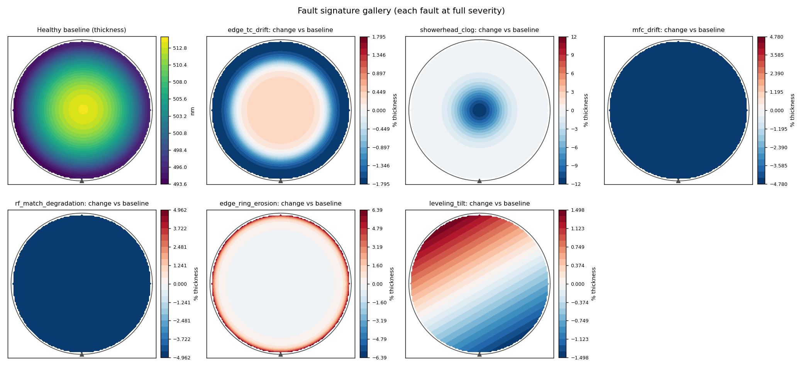
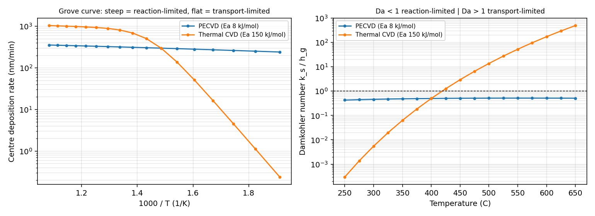
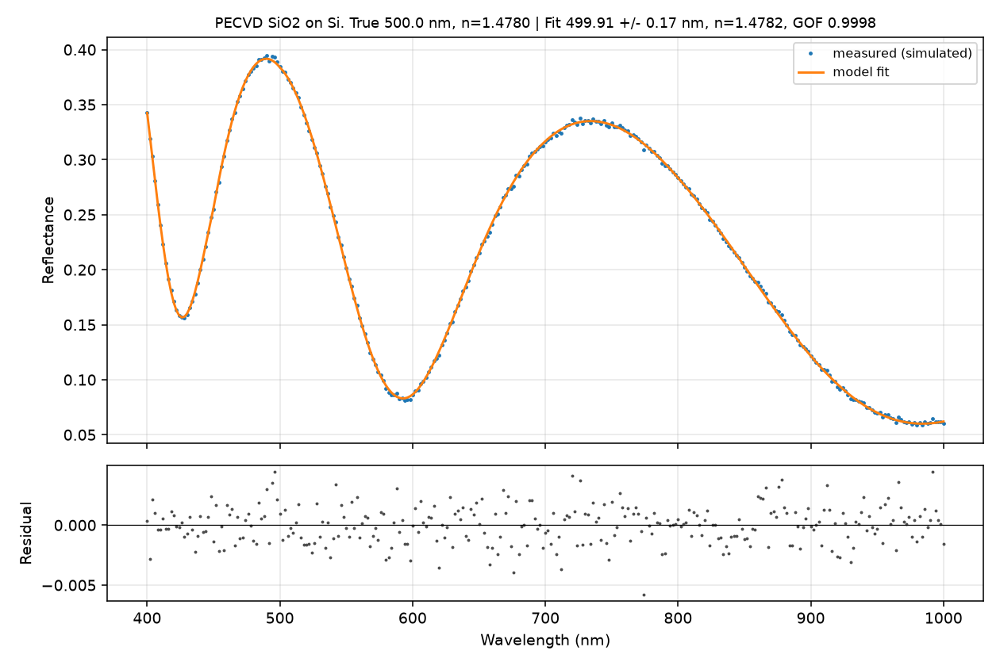
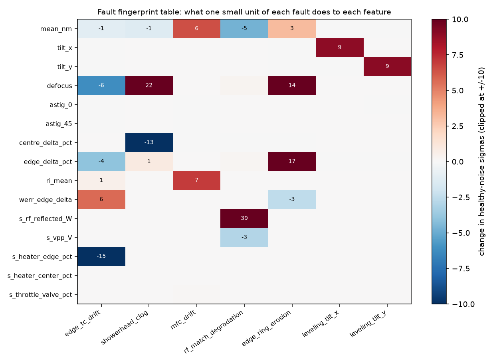
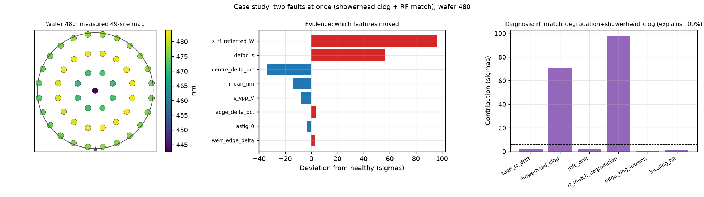

# FilmTwin

A physics-based digital twin of a single-wafer PECVD chamber, plus the analysis tools a thin-film process engineer uses every day: wafer maps, uniformity metrics, fault signatures, SPC, DOE and root-cause analysis.

FilmTwin answers one question: **when a wafer's thickness map goes out of spec, what in the chamber caused it, and what should be changed?**

Real fab data is proprietary, so almost no public datasets come with a known root cause. FilmTwin generates realistic wafer maps and tool sensor data for chambers that age and develop faults, with the true cause recorded for every wafer. That makes it possible to build and *score* diagnosis methods.



## Status

| Module | What it does | Status |
|---|---|---|
| 1. Chamber twin | Grove-model deposition, radial profiles, aging, 6 fault types, sensors, datasets | **Done** |
| 2. Metrology engine | Simulated spectral reflectometer, transfer-matrix fitting of thickness and index, gauge study | **Done** |
| 3. Root-cause diagnosis | Zernike features, context-aware T-squared detection, physics-based signature decomposition, incident reports | **Done** |
| 4. DOE, SPC, run-to-run | Factorial/RSM designs, control charts with OCAP, EWMA run-to-run control | Next |
| 5. Virtual metrology | VM model on the public PHM 2016 CMP dataset | Planned |

## Headline results (Module 3, scored against ground truth)

Trained on two healthy runs, tested on new random seeds:

| Scenario | Alarm delay (wafers) | NU chart delay | Mean chart delay | Correct diagnosis |
|---|---|---|---|---|
| edge_tc_drift | 26 | 52 | 180 | 98.9 % |
| showerhead_clog | 30 | 43 | 238 | 98.7 % |
| mfc_drift | 83 | missed | 62 | 96.2 % |
| rf_match_degradation | 11 | missed | 43 | 99.0 % |
| edge_ring_erosion | 40 | 29 | 184 | 98.0 % |
| leveling_tilt | 2 | 2 | missed | 100 % |
| mixed_clog_and_match | 29 | 31 | 207 | 94.7 % (both faults) |

- **Zero false alarms** on a fresh healthy run.
- **97.8–98.1 % accuracy** on three chambers the fault signatures were *not* built from.
- On a fault that is **not** in the library (heater height drift), every flagged wafer was labelled "unknown" rather than blamed on the wrong part.
- The classic charts are sometimes faster. The mean chart beats T-squared on MFC drift, and the NU chart beats it on edge ring wear. Neither one says what is wrong. See "Limitations".

## Quick start (Mac Terminal)

Requires Python 3.8 or newer.

```bash
cd filmtwin
python3 -m venv .venv
source .venv/bin/activate
pip install -r requirements.txt

python3 tests/test_module1.py          # 11 physics and simulator checks
python3 tests/test_module2_3.py        # 15 metrology and diagnosis checks
python3 examples/run_module1_demo.py   # chamber figures + datasets (~10 s)
python3 examples/run_module2_demo.py   # metrology figures (~15 s)
python3 examples/run_module3_demo.py   # detection, diagnosis, scorecard, reports (~1 min)
```

Figures land in `outputs/figures/`, datasets in `data/` (about 32 MB, so `data/` is git-ignored; anyone can regenerate it with the demo script).

## Project layout

```
filmtwin/
  physics.py    Grove model, temperature/plasma/gas profiles, film properties
  faults.py     Fault definitions and normal chamber aging
  chamber.py    Simulator: wafers, lots, cleans, sensors, metrology tables
  scenarios.py  8 ready-made fault stories with known root causes
  regime.py     Reaction- vs transport-limited analysis, knob sensitivities
  metrics.py    Uniformity metrics (1-sigma and range NU), radial profiles
  plots.py      Wafer maps, fault gallery, run charts, Grove curve
  wafer.py      300 mm wafer geometry, 49-site pattern, dense grids
  optics.py     Silicon and Cauchy material models, transfer-matrix reflectance
  metrology.py  Simulated reflectometer, spectrum fitting, gauge study
  zernike.py    Zernike polynomials and fast wafer-map decomposition
  features.py   Per-wafer feature vector: map shape, film, sensors
  diagnosis.py  Healthy reference model, T-squared detection, signature decomposition, scoring
examples/run_module1_demo.py, run_module2_demo.py, run_module3_demo.py
tests/test_module1.py, test_module2_3.py
docs/         Interview notes for each module
```

## The physics

At every point on the wafer the deposition rate follows the Grove model for CVD:

```
G = eta * V_m * [ k_s * h_g / (k_s + h_g) ] * C_g * g(r)
```

- `k_s` surface reaction rate constant: Arrhenius in local wafer temperature, scaled by RF-generated radical supply (saturating with power) and a radial plasma profile.
- `h_g = D / delta` gas-phase mass transfer coefficient. Diffusivity `D` scales as `T^1.75 / P`; boundary layer `delta` scales with showerhead-to-wafer spacing.
- `C_g` precursor concentration from partial pressure and gas temperature.
- `g(r)` radial precursor depletion: consumption over the wafer compared with gas supply, so more total flow means less depletion.
- `V_m`, `eta` film molar volume and incorporation efficiency.

The **Damkohler number** `Da = k_s / h_g` sets the regime. With `Da << 1` the process is reaction-limited and rate follows temperature. With `Da >> 1` it is transport-limited and rate follows flow, pressure and spacing. The default PECVD recipe sits at `Da ≈ 0.5` (mixed). `regime.py` contrasts it with a hypothetical thermal CVD chamber that shows the full textbook curve.



Spatial non-uniformity comes from:

- two heater zones plus edge heat loss,
- a centre-high plasma term and an edge-ring term,
- radial gas depletion,
- planar tilt,
- a small random field, wafer-to-wafer noise and gauge noise.

Film properties include refractive index (rises as the film turns Si-rich) and wet etch rate ratio (falls with deposition temperature). These are illustrative trends with plausible magnitudes.

Default recipe (SiH4 + N2O PECVD oxide): 400 C, 2.5 Torr, 600 W, 150/3000 sccm, 10 mm gap, 103 s. This gives about 500 nm at ~290 nm/min with 1.3 % 1-sigma non-uniformity.

## Scenarios

Each scenario is 600 wafers (24 lots of 25) with a chamber clean every 300 wafers.

| Scenario | Map signature | Sensor clue |
|---|---|---|
| `baseline` | Stable centre-thick bowl | Vpp creeps up between cleans |
| `edge_tc_drift` | Edge ~3 % thin, edge WERR up | Edge heater power falls |
| `showerhead_clog` | Centre thins; NU *improves* first, then worsens | None |
| `mfc_drift` | Mean shift, no shape change, RI drops | None (MFC reports setpoint) |
| `rf_match_degradation` | Mean shift, no shape change, RI flat | Reflected power up, Vpp down |
| `edge_ring_erosion` | Edge goes thin to thick; NU dips then rises | Weak |
| `leveling_tilt` | Step change after clean; one side thick | None (timing is the clue) |
| `mixed_clog_and_match` | Mean drop plus shape change | Reflected power explains only part |

Two lessons are built in on purpose. First, `mfc_drift` and `rf_match_degradation` produce the same thickness map, so you need refractive index or sensor data to tell them apart. Second, in `showerhead_clog` and `edge_ring_erosion` the 1-sigma NU looks *better* for a while, so an NU-only SPC chart misses a real fault.

## Data dictionary

`data/<scenario>_wafers.csv` has one row per wafer:

- **Context:** `wafer_id`, `lot_id`, `slot`, `chamber`, `timestamp`, `wafers_since_clean`, `rf_hours_since_clean`, `pm_event`, `sampled_for_metrology`
- `r_*` the recipe used
- `s_*` tool sensors as the tool reports them (pressure, throttle valve, RF forward/reflected, Vpp, heater powers, precursor flow reading, wall temperature)
- `m_*` metrology summaries (mean thickness, NU 1-sigma and range, RI, WERR, rate)
- `gt_*` **ground truth**: severity of each fault and a combined `gt_label`. A real fab never gives you these; use them only to score your methods.

`data/<scenario>_sites.csv` has one row per measured site: `site`, `x_mm`, `y_mm`, `thickness_nm`, `refractive_index`, `werr`, `temperature_C`.

## Module 2: metrology engine

A spectral reflectometer shines broadband light on the wafer and records reflectance vs wavelength. Light reflected from the top of the film interferes with light from the film/silicon interface, so the spectrum oscillates. The spacing of the oscillations encodes optical thickness (n × d), and their shape encodes n. `metrology.py` simulates the raw spectrum, then fits it back the way a real tool does:

1. a **global grid search** over thickness, because the error surface has many local minima,
2. **Levenberg-Marquardt** refinement of thickness, Cauchy index and a reflectance scale factor (which absorbs calibration error),
3. **uncertainty and n-d correlation** from the fit covariance, plus a goodness-of-fit (GOF) check.



Results on a 500 nm PECVD oxide:

- **Repeatability:** 0.15 nm in thickness and 0.0005 in index.
- **Precision-to-tolerance:** 0.03 against a ±3 % spec, where a P/T below 0.1 means the gauge is capable.
- **Full-wafer check:** measuring a Module 1 wafer site by site recovers the true map with 0.14 nm scatter.

Module 1 assumes 0.4 nm gauge noise, which is conservative: it allows for reproducibility effects (stage placement, tool-to-tool) on top of repeatability.

Three failure modes are built in, because knowing when to distrust the number is the real skill:

- **Wrong valley.** Start the local optimizer without the global search and it converges to a wrong thickness. The GOF check catches it.
- **Thin films.** Below about 50 nm there are too few fringes to separate n from d, so the index uncertainty explodes. The fitter then fixes n automatically and says so. Fixing n at the wrong value adds a systematic thickness bias.
- **Wrong stack model.** Fit a single-layer model to oxide on nitride and you get a wrong thickness (612 nm instead of 500). A low GOF is the warning sign.

## Module 3: detection and root-cause diagnosis

Each wafer is reduced to 15 features:

- mean thickness,
- Zernike tilt, defocus and astigmatism,
- centre and edge deltas,
- refractive index,
- edge wet-etch shift,
- five tool sensors.

Then three steps run on those features:

1. **Healthy reference.** A context model learns normal behaviour, including the rate drift between cleans and the low first wafer. Normal aging is not flagged as a fault.
2. **Detection.** Hotelling's T-squared combines all features while accounting for how they normally co-vary. The alarm fires when 3 of the last 5 wafers exceed the limit.
3. **Diagnosis.** Each wafer's deviation is decomposed into a non-negative combination of **physics-based fault signatures**. Each signature is computed from Module 1's model: what one small unit of each fault does to every feature. This is physics-informed rather than a black-box classifier, so it can:
   - report two simultaneous faults,
   - estimate each fault's severity,
   - say "unknown" when no signature explains the data.





Every scenario also gets an auto-written incident report in `outputs/reports/`. Each report contains:

- when the alarm fired,
- the diagnosis and estimated severity,
- the strongest evidence,
- the playbook for the *diagnosed* fault.

## Limitations (stated plainly)

- The model is physically motivated but **not calibrated to any commercial tool**. Constants were set so the default recipe lands in a realistic window. Absolute numbers will differ from a real chamber; the directions and the relative signatures are the point.
- Film-property relationships (RI, WERR) are qualitative trends, not a validated film model.
- The gas model is 1D radial. There is no CFD, plasma chemistry or sheath physics.
- Faults are idealized single mechanisms. Real excursions are messier and often overlap, which is why `mixed_clog_and_match` exists.

- **Module 3 diagnosis is tested on data from the same model family that produced its signatures.** That is the biggest caveat. The robustness checks (three different chambers, plus one unseen fault) reduce it but do not remove it. Real faults are messier, and real signatures would be built from a mix of physics, historical incidents and engineering judgement.
- T-squared pools 15 features, so a shift in a single feature is diluted. That is why the plain mean chart catches MFC drift faster. A production system would run both multivariate and univariate charts.
- Signatures are linear approximations. Edge ring severity is slightly underestimated at the high end, where the physics becomes nonlinear.

Module 5 adds a real public dataset so the analysis methods are also proven on real fab data.

## Using it in your own code

```python
from filmtwin import ChamberSimulator, FaultEvent, Recipe, Hardware

sim = ChamberSimulator(
    recipe=Recipe(pressure_torr=3.0),
    faults=[FaultEvent("showerhead_clog", start_wafer=100, severity=0.08, ramp_wafers=300)],
    seed=1,
)
wafers, sites = sim.run(400)
print(wafers[["wafer_id", "m_thickness_mean_nm", "m_nu_1sigma_pct", "gt_label"]].tail())
```
