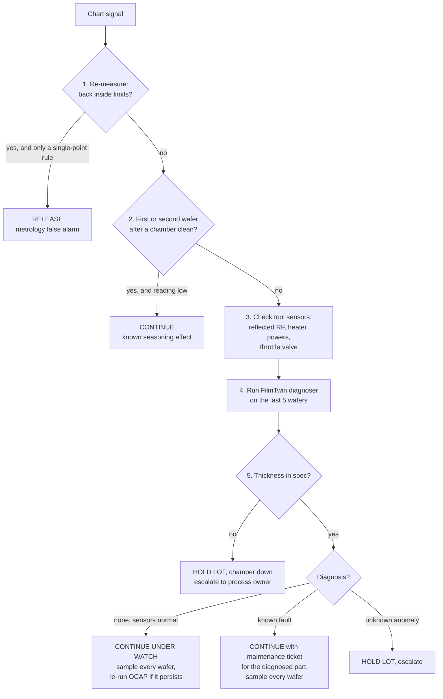

# OCAP: PECVD oxide mean thickness, chamber CH-A

**Out-of-Control Action Plan.** When a control chart fires, this is what the engineer or technician on shift does, in order. It is implemented as code in `filmtwin/spc.py` (`run_ocap`), so every decision it makes is logged. See `outputs/reports/ocap_mfc_drift.md` for a real run.

**Trigger:** any Western Electric rule on the context-corrected mean-thickness I chart, or an EWMA signal.
**Spec:** 500 ± 15 nm.

## Why each step is there

1. **Re-measure first.** Metrology errors are common and cheap to rule out, and taking a chamber down for a bad measurement costs hours of tool time.
2. **Check context.** The first wafer after a wet clean runs low every time, because the chamber isn't seasoned yet. That is known behaviour, not an excursion.
3. **Sensors next.** They are already logged for every wafer, so this costs nothing. A sensor outside its own limits points straight at hardware.
4. **Diagnose.** The Module 3 diagnoser turns "something moved" into "this part, this badly." That decides whether the chamber can keep running while a fix is scheduled.
5. **Disposition.** The decision rule weighs product risk (is it out of spec?) against evidence (does anything confirm the chart?). Charts with several run rules raise occasional false alarms (about 6 episodes per 600 healthy wafers here), so a lone chart signal with no confirmation should not take a chamber down.

## Reaction plan by diagnosed cause

| Diagnosis | First action | Owner |
|---|---|---|
| `rf_match_degradation` | Inspect the match network, retune or replace | Equipment |
| `mfc_drift` | MFC rate-of-rise check, recalibrate or replace | Equipment |
| `edge_tc_drift` | Verify with a temperature-sensing wafer, replace the thermocouple | Equipment |
| `showerhead_clog` | Inspect and clean or replace the faceplate | Equipment |
| `edge_ring_erosion` | Replace the edge ring, check ring RF-hours | Equipment |
| `leveling_tilt` | Re-level the heater, check lift pins, add a post-PM uniformity qual | Equipment |
| `unknown` | Hold and escalate; review recent PM, recipe and hardware changes | Process owner |
